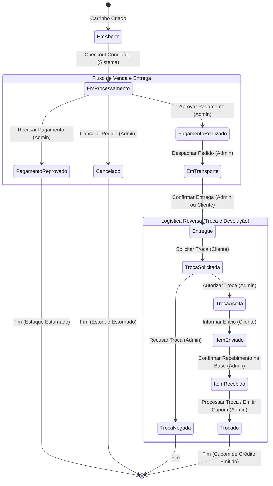

# 🔁 Máquina de Estados Operacionais e Logística Reversa

> Documentação técnica da Máquina de Estados Finita do **Glaciar E-Commerce**, cobrindo o ciclo de vida completo do pedido, gestão logística, matriz de transições, atores autorizados, logística reversa de trocas e blindagens contra burlas.

---

## 📌 1. Visão Geral da Máquina de Estados

O gerenciamento do ciclo de vida do pedido pós-checkout é regido por uma **Máquina de Estados Finita e Estrita** encapsulada no Domínio ([`PedidoMaquinaEstados.cs`](file:///c:/Users/gusta/OneDrive/Área%20de%20Trabalho/estudos/fatec/5%20Sem/LES/glaciar/src/glaciar.Domain/Entities/Vendas/PedidoMaquinaEstados.cs)), garantindo que seja impossível burlar etapas do fluxo de compra, expedição ou devolução.

---

## 📊 2. Diagrama de Estados do Pedido



---

## 📋 3. Matriz de Transições e Atores Autorizados

Cada transição válida exige obrigatoriamente que o pedido esteja no **status imediatamente anterior correto** e que o **ator** tenha autorização formal:

| Status Atual | Próximo Status Permitido | Ator Autorizado | Efeitos Colaterais Automáticos de Domínio |
| :--- | :--- | :--- | :--- |
| **`EmAberto`** | `EmProcessamento` | `Sistema` | Vincula endereço físico, calcula frete, debita cupons/cartões e realiza baixa atômica de estoque. |
| **`EmProcessamento`** | `PagamentoRealizado` | `Administrador` | Atualiza pagamentos vinculados para `PagamentoRealizado`. Libera pedido para expedição. |
| **`EmProcessamento`** | `PagamentoReprovado` | `Administrador` | Atualiza pagamentos para `PagamentoRecusado`, cancela entrega e **estorna atomicamente os itens ao estoque**. |
| **`EmProcessamento`** | `Cancelado` | `Administrador` | Atualiza pagamentos para `PagamentoCancelado`, cancela entrega e **estorna atomicamente os itens ao estoque**. |
| **`PagamentoRealizado`** | `EmTransporte` | `Administrador` | Atualiza entrega para `EmTransporte` e preenche `DataDespacho = DateTime.UtcNow`. |
| **`EmTransporte`** | `Entregue` | `Administrador` ou `Cliente` | Atualiza entrega para `Entregue` e preenche `DataEntrega = DateTime.UtcNow`. Habilita janela de troca. |
| **`Entregue`** | `TrocaSolicitada` | `Cliente` | Abre o protocolo de logística reversa. Apenas o cliente dono do pedido pode solicitar. |
| **`TrocaSolicitada`** | `TrocaAceita` | `Administrador` | Libera a emissão da autorização de postagem/código reverso para o cliente despachar o produto. |
| **`TrocaSolicitada`** | `TrocaNegada` | `Administrador` | Encerra a solicitação de devolução sem emissão de crédito. |
| **`TrocaAceita`** | `ItemEnviado` | `Cliente` | O cliente confirma a postagem do item nos Correios/transportadora informando o rastreio. |
| **`ItemEnviado`** | `ItemRecebido` | `Administrador` | A base logística confirma a chegada do pacote físico e inicia a triagem e conferência técnica. |
| **`ItemRecebido`** | `Trocado` | `Administrador` | **RN0037:** Calcula o crédito de troca (valor dos itens deduzindo cupons promocionais) e **emite um novo Cupom de Troca** pessoal para o cliente. |

> [!NOTE]
> **Estados Finais Inalteráveis:** Os status `Cancelado`, `PagamentoReprovado`, `TrocaNegada` e `Trocado` são estados terminais. Nenhuma transição de saída é permitida a partir deles.

---

## 🛡️ 4. Pilares da Blindagem Contra Burlas

### 1. Encapsulamento Rígido no Domínio (DDD)
A propriedade `Pedido.Status` possui **setter privado** (`public StatusPedido Status { get; private set; }`). Nenhuma camada externa (nem Controllers, nem Services) consegue alterar o status por atribuição direta. 

A única porta de entrada é o método:
```csharp
public ResultadoTransicaoPedido AlterarStatus(StatusPedido novoStatus, AtorTransicao ator)
```
Se a transição não constar na matriz da máquina de estados ou o ator não tiver permissão, uma `DomainValidationException` é lançada imediatamente antes de qualquer persistência.

### 2. Dupla Blindagem (API e Frontend Integrados)
* **No Backend:** A API rejeita qualquer tentativa de pular etapas ou manipulação fraudulenta de payload via `PATCH`.
* **No Frontend:** A API devolve nos DTOs de resposta a lista dinâmica `proximosStatus` calculada pelo domínio para aquele ator. O JavaScript renderiza nos `<select>` e botões **exclusivamente as ações válidas para o estado atual**. Se não houver transição disponível, o componente de seleção é omitido.

### 3. Prevenção de Concorrência e Duplo Clique (Optimistic Concurrency)
No mapeamento do EF Core, `Pedido.Status` está configurado como `IsConcurrencyToken()`:
```csharp
modelBuilder.Entity<Pedido>()
    .Property(p => p.Status)
    .HasConversion<string>()
    .IsConcurrencyToken();
```
Toda operação de atualização gera um SQL condicional:
```sql
UPDATE "Pedidos" SET "Status" = @novoStatus, "UpdatedAt" = @agora 
WHERE "Id" = @id AND "Status" = @statusAnteriorLido;
```
Se dois administradores clicarem simultaneamente em "Aprovar" ou houver duplo clique rápido ao finalizar a troca, apenas a primeira requisição afetará o registro. A segunda resultará em `DbUpdateConcurrencyException`, capturada e traduzida para `ConflitoDeConcorrenciaException` (HTTP 409 Conflict), impedindo a emissão duplicada de cupons ou estornos duplos.

### 4. Isolamento Contra IDOR (Insecure Direct Object Reference)
Nas chamadas realizadas pelo cliente (`PATCH /api/pedidos/{id}/status`), a busca no repositório exige obrigatoriamente o filtro do cliente logado:
```csharp
var pedido = await _pedidoRepository.GetParaAlteracaoStatusAsync(pedidoId, usuarioId);
```
Se um cliente mal-intencionado tentar alterar o status de um pedido pertencente a outro usuário, o sistema retorna `EntidadeNaoEncontradaException` (HTTP 404), sem revelar a existência do registro.

---

## 🔗 Referências Relacionadas
* [Contratos de API para Mudança de Status](./CONTRATOS_API.md#3-transições-de-status-do-pedido)
* [Arquitetura de Domínio e DDD](./ARQUITETURA.md#️-caso-de-estudo-real-do-projeto-glaciar-máquina-de-estados-operacionais)
* [Testes Automatizados de Estados e Logística Reversa](./CASOS_DE_TESTE.md#-25-módulo-ciclo-logístico-e-estados-troca-estados)
