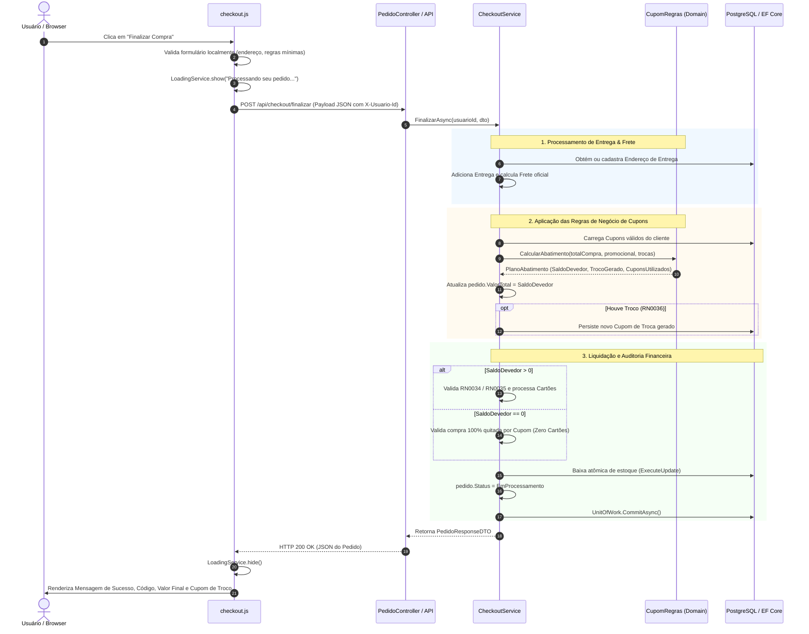
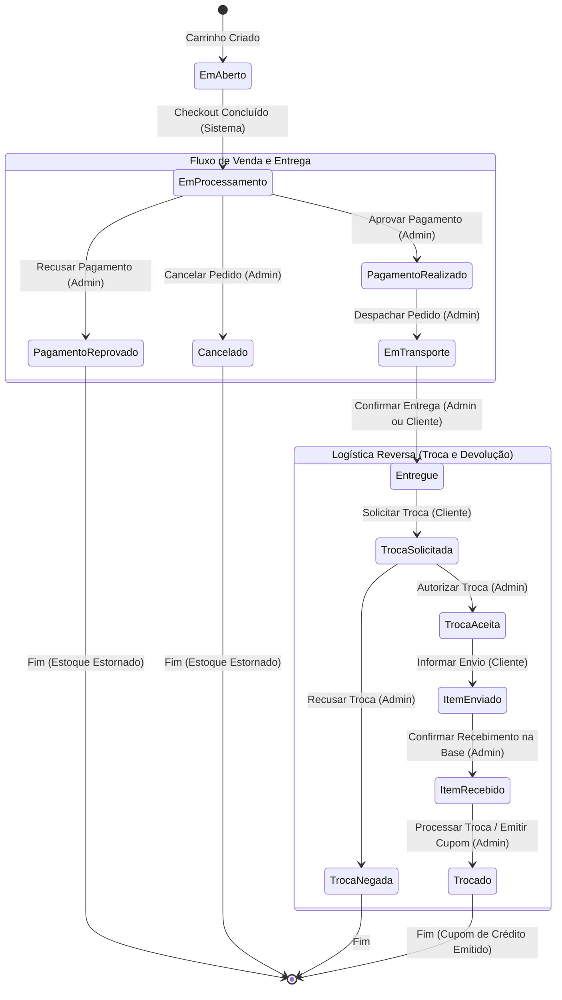

# 🏔️ Glaciar E-Commerce — Arquitetura de Carrinho, Checkout e Regras de Negócio

> Documentação Técnica Oficial e Definitiva dos Módulos de Vendas, Gestão de Carrinho, Checkout Multimeios e Automação de Qualidade (E2E).

---

## 📌 1. Visão Geral do Projeto

O **Glaciar** é uma plataforma de comércio eletrônico desenvolvida para equipamentos e vestuário térmico de alta performance. O core transacional do sistema é estruturado em um fluxo fluido e orientado a estados:

```
[ Catálogo / Produto ] ➔ [ Carrinho de Compras ] ➔ [ Checkout Transacional ] ➔ [ Confirmação / Pedidos ]
```

1. **Catálogo & Produto:** Seleção de itens por SKU (tamanho, cor) e validação de disponibilidade em tempo real.
2. **Carrinho de Compras:** Gestão otimizada de itens no lado do cliente com sincronização em lote atômica.
3. **Checkout:** Seleção/cadastro de endereço de entrega, cálculo de frete por estado, aplicação progressiva de cupons (promocionais e de troca) e liquidação do saldo devedor via múltiplos cartões de crédito.
4. **Confirmação & Pedidos:** Persistência transacional com baixa atômica de estoque, geração de troco em cupom (quando aplicável) e registro imediato no status **`EmProcessamento`**.

### 🛠️ Stack Tecnológica

| Camada | Tecnologia | Destaques Técnicos |
| :--- | :--- | :--- |
| **Frontend** | Vanilla JavaScript (ES6+), HTML5, Vanilla CSS | Arquitetura modular sem frameworks pesados; componentização nativa (Toast, Loading Overlay, Layout); zero dependências em runtime para máxima performance. |
| **Backend** | .NET 10 (C#) | **Clean Architecture** e **DDD**; separação estrita de camadas (`Domain`, `Application`, `Infrastructure`, `API`); mapeamento com AutoMapper; validação fluida com Domain Exceptions. |
| **Persistência** | PostgreSQL (Supabase) & Entity Framework Core | Migrações versionadas, transações atômicas com **Unit of Work**, `ExecuteUpdate` para concorrência de estoque e `AsSplitQuery` para leitura eficiente de agregados complexos. |
| **Testes & QA** | Cypress 16+ | Suíte automatizada E2E e testes de contrato HTTP; uso de `Cypress.expose()`, mocks inteligentes com `cy.intercept()` e testes diretos de API via `cy.request()`. |

---

## 🏛️ 2. Arquitetura de Front-end

### 2.1 Gestão de Estado Local (Client-side State Management) no Carrinho

Tradicionalmente, aplicações web disparam requisições `PUT` ou `PATCH` a cada incremento (`+`) ou decremento (`-`) de quantidade no carrinho. No **Glaciar**, adotou-se uma decisão arquitetural de **Gestão Local com Sincronização Atômica Diferencial (Batch Diff)**:

* **Experiência do Usuário (UX Fluida):** Ações de quantidade alteram instantaneamente o estado em memória (`estado.itens`), recalculando subtotais, estoque limite e valores estimados na tela sem qualquer delay de rede ou oscilação de layout (*layout thrashing*).
* **Snapshot de Comparação:** A aplicação retém o snapshot oficial do servidor (`estado.quantidadesOriginais`). Quando o usuário clica em **"Continuar para o checkout"**, a função `montarPayloadAlteracoes()` gera um payload diferencial contendo apenas os itens alterados ou removidos (`quantidade: 0`).
* **Sincronização em Lote (`PUT /api/carrinho/itens`):** Uma única chamada HTTP atômica sincroniza todas as modificações no banco antes de navegar para `checkout.html`. Caso o usuário tente fechar a aba com alterações pendentes, o evento `beforeunload` alerta preventivamente contra perda de dados.

```javascript
// Exemplo conceitual do cálculo de diff no carrinho (carrinho.js)
function montarPayloadAlteracoes() {
    const atuais = new Map(estado.itens.map(({ id, quantidade }) => [id, quantidade]));
    return [...estado.quantidadesOriginais]
        .map(([itemId, original]) => ({ itemId, quantidade: atuais.get(itemId) ?? 0, original }))
        .filter(({ quantidade, original }) => quantidade !== original)
        .map(({ itemId, quantidade }) => ({ itemId, quantidade }));
}
```

### 2.2 Serviços Globais de UI/UX

Para garantir consistência e evitar concorrência acidental de interface, o front-end conta com dois serviços singleton:

* **`LoadingService`:**
  - Gerencia um overlay bloqueante (`.loading-overlay`) com spinner estilizado e backdrop blur.
  - Ativado automaticamente em operações assíncronas críticas (processamento de checkout, sincronização do carrinho, validação de cupons).
  - Impede disparos acidentais por múltiplos cliques (*double submission*).
* **`NotificationService` (`window.Toast`):**
  - Sistema de alertas reativo padronizado posicionado no canto inferior da viewport (`#global-toast-container`).
  - Suporte a mensagens categorizadas: `showError()`, `showSuccess()`, `showInfo()`.
  - Animação de entrada e saída por CSS, botão de fechamento manual e autodismiss configurável (5 segundos por padrão).

---

## ⚙️ 3. Regras de Negócio e Backend (O Core do Sistema)

O processamento do checkout é orquestrado pelo serviço de aplicação [`CheckoutService.cs`](file:///c:/Users/gusta/OneDrive/Área%20de%20Trabalho/estudos/fatec/5%20Sem/LES/glaciar/src/glaciar.Application/Services/Vendas/CheckoutService.cs), delegando regras puras de cálculo de cupons para a classe de domínio puro [`CupomRegras.cs`](file:///c:/Users/gusta/OneDrive/Área%20de%20Trabalho/estudos/fatec/5%20Sem/LES/glaciar/src/glaciar.Application/Services/Vendas/CupomRegras.cs) e encapsulando toda a persistência em uma transação única via `UnitOfWork`.

### 3.1 Regras de Negócio Implementadas

```
                                  REGRAS DE PAGAMENTO E CUPONS
┌─────────────────────────────────────────────────────────────────────────────────────────────────┐
│                                                                                                 │
│  [ RN0033 ] Máx. 1 Cupom Promocional      [ RN0034 ] Min. R$ 10,00 por Cartão                   │
│  • Apenas 1 promocional por compra.       • Cobrança mínima de R$ 10,00 em cada cartão de       │
│  • Cupons de troca são ilimitados.          crédito quando não houver abatimento especial.      │
│                                                                                                 │
│  [ RN0035 ] Exceção de Saldo Misto        [ RN0036 ] Troco em Cupom de Troca                    │
│  • Se cupons abaterem o saldo deixando    • Cupons de troca superiores ao total quitam 100%     │
│    restante < R$ 10,00, o cartão pode       da compra (R$ 0,00) e geram um NOVO cupom com o     │
│    ser cobrado com o valor residual.        valor excedente. Cupons extras são rejeitados.      │
│                                                                                                 │
└─────────────────────────────────────────────────────────────────────────────────────────────────┘
```

#### 🏷️ RN0033 — Limite de Apenas Um Cupom Promocional
* É permitido utilizar **no máximo 1 (um) cupom promocional** por compra.
* Cupons de **troca** podem ser acumulados sem restrição de quantidade.
* **Ordem de Aplicação:** O cupom promocional possui prioridade e é abatido primeiro do total da compra. Em seguida, os cupons de troca são debitados sucessivamente sobre o saldo devedor restante.

#### 💳 RN0034 — Pagamento Multimeios com Piso Mínimo de R$ 10,00
* O cliente pode distribuir o valor a ser pago entre múltiplos cartões de crédito.
* Cada cartão participante da transação deve receber uma cobrança de **no mínimo R$ 10,00**.
* A soma dos valores declarados nos cartões deve corresponder exatamente ao saldo devedor restante da compra. Caso a soma seja divergente ou algum cartão receba cobrança inferior a R$ 10,00, a transação é bloqueada com `DomainValidationException` (HTTP 400).

#### 🔀 RN0035 — Exceção do Valor Mínimo em Pagamento Misto (Cupom + Cartão)
* **Regra de Flexibilização:** Se o cliente aplicar cupons de desconto que cubram quase a totalidade da compra, resultando em um **saldo devedor residual inferior a R$ 10,00** (por exemplo: total de R$ 105,00, cupom abate R$ 100,00, restando R$ 5,00), o sistema **permite** a cobrança deste valor menor que R$ 10,00 no cartão de crédito.
* Essa exceção viabiliza a conclusão da compra sem forçar o cliente a emitir cobranças artificiais.

#### 🪙 RN0036 — Troco em Cupom de Troca e Proibição de Cupons Desnecessários
* Quando o valor acumulado dos cupons de troca supera o valor total da compra (exemplo: compra de R$ 100,00 paga com cupom de troca de R$ 150,00):
  1. A compra é liquidada integralmente (saldo devedor vai para **R$ 0,00**, dispensando cartões).
  2. O backend gera automaticamente um **novo Cupom de Troca** com o valor do troco (R$ 50,00), vinculado ao cliente e gravado no banco de dados.
  3. `pedido.ValorTotal` é persistido com o valor líquido pago (`R$ 0,00`).
* **Proteção contra Desperdício:** Se o saldo do pedido já estiver totalmente coberto por cupons anteriores, a inclusão de cupons de troca adicionais é **proibida**, evitando que o cliente consuma cupons desnecessariamente.

#### 🔒 Validação Estrutural Obrigatória de Novos Cartões
* Sempre que o cliente informa um novo cartão de crédito no checkout, o backend valida rigorosamente a estrutura cadastral (número com tamanho e formato válidos, bandeira cadastrada, mês entre 1 e 12, ano igual ou superior ao ano corrente, e CVV com 3 ou 4 dígitos).
* Essa validação é **obrigatória e independente** do usuário marcar ou não a opção de salvar o cartão no perfil do cliente (`salvarNoPerfil: true/false`).

---

## 🔄 4. Diagrama de Sequência do Checkout

O fluxo abaixo ilustra a interação completa entre o usuário, o navegador e as camadas do backend:



---

## 📡 5. Contratos de API (Endpoints & Payloads)

### 5.1 Finalizar Checkout

* **Endpoint:** `POST /api/checkout/finalizar`
* **Headers:**
  - `Content-Type: application/json`
  - `X-Usuario-Id: 42`

#### Payload de Envio (Request Body)
Demonstração completa contemplando novo endereço com salvamento no perfil, cupons aplicados e múltiplos cartões:

```json
{
  "usuarioEnderecoId": null,
  "novoEndereco": {
    "cep": "01310100",
    "logradouro": "Avenida Paulista",
    "numero": "1000",
    "complemento": "Andar 15",
    "bairro": "Bela Vista",
    "cidade": "São Paulo",
    "estado": "SP",
    "salvarNoPerfil": true,
    "apelido": "Escritório Paulista"
  },
  "codigosCupons": [
    "GLACIAR100",
    "TROCA50"
  ],
  "cartoes": [
    {
      "usuarioCartaoId": 5,
      "novoCartao": null,
      "valor": 30.00
    },
    {
      "usuarioCartaoId": null,
      "novoCartao": {
        "numero": "4916511493269188",
        "bandeira": "Visa",
        "mesValidade": 11,
        "anoValidade": 2028,
        "cvv": "123",
        "salvarNoPerfil": true
      },
      "valor": 20.00
    }
  ]
}
```

#### Payload de Retorno (Response Body — HTTP 200 OK)

```json
{
  "id": 850,
  "codigo": "PED-20261006-850",
  "data": "2026-10-06T19:50:00Z",
  "status": "EmProcessamento",
  "subtotal": 180.00,
  "valorFrete": 20.00,
  "valorAbatidoCupons": 150.00,
  "valorTotal": 50.00,
  "valorPagoCartoes": 50.00,
  "enderecoEntrega": {
    "id": 15,
    "cep": "01310100",
    "logradouro": "Avenida Paulista",
    "numero": "1000",
    "complemento": "Andar 15",
    "bairro": "Bela Vista",
    "cidade": "São Paulo",
    "estado": "SP"
  },
  "itens": [
    {
      "id": 101,
      "estoqueId": 4,
      "produtoId": 2,
      "nomeProduto": "Casaco Polar Térmico",
      "tamanho": "G",
      "cor": "Preto",
      "sku": "CAS-POL-G-PRT",
      "precoUnitario": 180.00,
      "quantidade": 1,
      "subtotal": 180.00
    }
  ],
  "pagamentos": [
    {
      "id": 201,
      "valor": 30.00,
      "metodo": 1,
      "status": 1,
      "cartaoUltimosDigitos": "1234",
      "cartaoBandeira": "Mastercard"
    },
    {
      "id": 202,
      "valor": 20.00,
      "metodo": 1,
      "status": 1,
      "cartaoUltimosDigitos": "9188",
      "cartaoBandeira": "Visa"
    }
  ],
  "cuponsAplicados": [
    {
      "id": 99,
      "codigo": "GLACIAR100",
      "valorDesconto": 100.00,
      "categoria": "Promocional"
    },
    {
      "id": 88,
      "codigo": "TROCA50",
      "valorDesconto": 50.00,
      "categoria": "Troca"
    }
  ],
  "cupomTrocaGerado": null
}
```

---

## 🧪 6. Estratégia de Qualidade e Testes E2E (Cypress)

A suíte de testes de ponta a ponta foi organizada na pasta `tests/cypress/e2e/`, adotando o padrão modular de nomenclatura do projeto:
* `(acao)-(escopo)-(caso).cy.js` — Testes de interface e jornada do usuário.
* `(acao)-(escopo)-(caso)-api.cy.js` — Testes diretos de API via requisições HTTP (`cy.request()`).

### 6.1 Matriz de Especificações de Teste

| Arquivo de Teste | Escopo / Regra Validada | Tipo |
| :--- | :--- | :--- |
| **[`gestao-carrinho-cliente.cy.js`](file:///c:/Users/gusta/OneDrive/Área%20de%20Trabalho/estudos/fatec/5%20Sem/LES/glaciar/tests/cypress/e2e/gestao-carrinho-cliente.cy.js)** | Listagem de múltiplos itens, incremento/decremento com recálculo visual em tempo real e sincronização diferencial (`PUT /api/carrinho/itens`) ao prosseguir para o checkout. | E2E (UI) |
| **[`checkout-simples-cliente.cy.js`](file:///c:/Users/gusta/OneDrive/Área%20de%20Trabalho/estudos/fatec/5%20Sem/LES/glaciar/tests/cypress/e2e/checkout-simples-cliente.cy.js)** | Compra concluída com endereço padrão e cartão vinculado pré-existentes. Validação do status `EmProcessamento` na tela de sucesso e na listagem de Meus Pedidos (`pedidos.html`). | E2E (UI) |
| **[`checkout-completo-cliente.cy.js`](file:///c:/Users/gusta/OneDrive/Área%20de%20Trabalho/estudos/fatec/5%20Sem/LES/glaciar/tests/cypress/e2e/checkout-completo-cliente.cy.js)** | Validação de bloqueio em formulário incompleto (Unhappy Path) e compra cadastrando novo endereço e novo cartão salvos no perfil do cliente (`salvarNoPerfil: true`). | E2E (UI) |
| **[`checkout-multiplos-cartoes-cliente.cy.js`](file:///c:/Users/gusta/OneDrive/Área%20de%20Trabalho/estudos/fatec/5%20Sem/LES/glaciar/tests/cypress/e2e/checkout-multiplos-cartoes-cliente.cy.js)** | **RN0034:** Bloqueio e exibição de toast de alerta quando um dos cartões for inferior a R$ 10,00 (`R$ 5,00`), e liberação bem-sucedida quando ambos respeitam o mínimo (`R$ 30,00` e `R$ 20,00`). | E2E (UI) |
| **[`checkout-pagamento-misto-cliente.cy.js`](file:///c:/Users/gusta/OneDrive/Área%20de%20Trabalho/estudos/fatec/5%20Sem/LES/glaciar/tests/cypress/e2e/checkout-pagamento-misto-cliente.cy.js)** | **RN0035:** Abatimento de cupom que reduz o saldo devedor restante para menos de R$ 10,00 (`R$ 5,00`), validando a exceção que permite a cobrança desse valor residual no cartão. | E2E (UI) |
| **[`checkout-troco-cupom-cliente.cy.js`](file:///c:/Users/gusta/OneDrive/Área%20de%20Trabalho/estudos/fatec/5%20Sem/LES/glaciar/tests/cypress/e2e/checkout-troco-cupom-cliente.cy.js)** | **RN0036:** Cupom de troca superior ao total da compra liquidando o pedido em R$ 0,00 sem cartão e emitindo novo cupom de troca com o troco gerado. | E2E (UI) |
| **[`checkout-vendas-api.cy.js`](file:///c:/Users/gusta/OneDrive/Área%20de%20Trabalho/estudos/fatec/5%20Sem/LES/glaciar/tests/cypress/e2e/checkout-vendas-api.cy.js)** | Testes diretos de API (`cy.request()`): validação de contratos de `GET /api/checkout/contexto`, `PUT /api/carrinho/itens`, rejeição HTTP 400 por cartão < R$ 10,00 sem cupom, e consulta de `GET /api/pedidos`. | API (HTTP) |

### 6.2 Execução Automatizada

```bash
# Executar toda a suíte de testes E2E e API
npx cypress run --project tests

# Executar os testes em modo interativo com interface visual
npx cypress open --project tests
```

---

---

## 🔁 7. Máquina de Estados Operacionais e Logística Reversa (Ciclo de Vida do Pedido)

O gerenciamento do ciclo de vida do pedido pós-checkout é regido por uma **Máquina de Estados Finita e Estrita** encapsulada no Domínio ([`PedidoMaquinaEstados.cs`](file:///c:/Users/gusta/OneDrive/Área%20de%20Trabalho/estudos/fatec/5%20Sem/LES/glaciar/src/glaciar.Domain/Entities/Vendas/PedidoMaquinaEstados.cs)), garantindo que seja impossível burlar etapas do fluxo de compra ou devolução.

### 7.1 Diagrama de Estados do Pedido



---

### 7.2 Matriz de Transições e Atores Autorizados

Cada transição válida exige obrigatoriamente que o pedido esteja no **status imediatamente anterior correto** e que o **ator** tenha autorização formal:

| Status Atual | Próximo Status Permitido | Ator Autorizado | Efeitos Colaterais Automáticos de Domínio |
| :--- | :--- | :--- | :--- |
| **`EmAberto`** | `EmProcessamento` | `Sistema` | Vincula endereço físico, calcula frete, debita cupons/cartões e realiza baixa atômica de estoque. |
| **`EmProcessamento`** | `PagamentoRealizado` | `Administrador` | Atualiza pagamentos vinculados para `PagamentoRealizado`. Libera pedido para expedição. |
| **`EmProcessamento`** | `PagamentoReprovado` | `Administrador` | Atualiza pagamentos para `PagamentoRecusado`, cancela entrega e **estorna atomicamente os itens ao estoque**. |
| **`EmProcessamento`** | `Cancelado` | `Administrador` | Atualiza pagamentos para `PagamentoCancelado`, cancela entrega e **estorna atomicamente os itens ao estoque**. |
| **`PagamentoRealizado`** | `EmTransporte` | `Administrador` | Atualiza entrega para `EmTransporte` e preenche `DataDespacho = DateTime.UtcNow`. |
| **`EmTransporte`** | `Entregue` | `Administrador` ou `Cliente` | Atualiza entrega para `Entregue` e preenche `DataEntrega = DateTime.UtcNow`. Habilita janela de troca. |
| **`Entregue`** | `TrocaSolicitada` | `Cliente` | Abre o protocolo de logística reversa. Apenas o cliente dono do pedido pode solicitar. |
| **`TrocaSolicitada`** | `TrocaAceita` | `Administrador` | Libera a emissão da autorização de postagem/código reverso para o cliente despachar o produto. |
| **`TrocaSolicitada`** | `TrocaNegada` | `Administrador` | Encerra a solicitação de devolução sem emissão de crédito. |
| **`TrocaAceita`** | `ItemEnviado` | `Cliente` | O cliente confirma a postagem do item nos Correios/transportadora informando o rastreio. |
| **`ItemEnviado`** | `ItemRecebido` | `Administrador` | A base logística confirma a chegada do pacote físico e inicia a triagem e conferência técnica. |
| **`ItemRecebido`** | `Trocado` | `Administrador` | **RN0037:** Calcula o crédito de troca (valor dos itens deduzindo cupons promocionais) e **emite um novo Cupom de Troca** pessoal para o cliente. |

> [!NOTE]
> **Estados Finais Inalteráveis:** Os status `Cancelado`, `PagamentoReprovado`, `TrocaNegada` e `Trocado` são estados terminais. Nenhuma transição de saída é permitida a partir deles.

---

### 7.3 Pilares da Blindagem Contra Burlas

#### 🛡️ 1. Encapsulamento Rígido no Domínio (DDD)
A propriedade `Pedido.Status` possui **setter privado** (`public StatusPedido Status { get; private set; }`). Nenhuma camada externa (nem Controllers, nem Services) consegue alterar o status por atribuição direta. 

A única porta de entrada é o método:
```csharp
public ResultadoTransicaoPedido AlterarStatus(StatusPedido novoStatus, AtorTransicao ator)
```
Se a transição não constar na matriz da máquina de estados ou o ator não tiver permissão, uma `DomainValidationException` é lançada imediatamente antes de qualquer persistência.

#### 🛡️ 2. Dupla Blindagem (API e Frontend Integrados)
* **No Backend:** A API rejeita qualquer tentativa de pular etapas ou manipulação fraudulenta de payload via `PATCH`.
* **No Frontend:** A API devolve nos DTOs de resposta a lista dinâmica `proximosStatus` calculada pelo domínio para aquele ator. O JavaScript renderiza nos `<select>` e botões **exclusivamente as ações válidas para o estado atual**. Se não houver transição disponível, o componente de seleção é omitido.

#### 🛡️ 3. Prevenção de Concorrência e Duplo Clique (Optimistic Concurrency)
No mapeamento do EF Core, `Pedido.Status` está configurado como `IsConcurrencyToken()`:
```csharp
modelBuilder.Entity<Pedido>()
    .Property(p => p.Status)
    .HasConversion<string>()
    .IsConcurrencyToken();
```
Toda operação de atualização gera um SQL condicional:
```sql
UPDATE "Pedidos" SET "Status" = @novoStatus, "UpdatedAt" = @agora 
WHERE "Id" = @id AND "Status" = @statusAnteriorLido;
```
Se dois administradores clicarem simultaneamente em "Aprovar" ou houver duplo clique rápido ao finalizar a troca, apenas a primeira requisição afetará o registro. A segunda resultará em `DbUpdateConcurrencyException`, capturada e traduzida para `ConflitoDeConcorrenciaException` (HTTP 409 Conflict), impedindo a emissão duplicada de cupons ou estornos duplos.

#### 🛡️ 4. Isolamento Contra IDOR (Insecure Direct Object Reference)
Nas chamadas realizadas pelo cliente (`PATCH /api/pedidos/{id}/status`), a busca no repositório exige obrigatoriamente o filtro do cliente logado:
```csharp
var pedido = await _pedidoRepository.GetParaAlteracaoStatusAsync(pedidoId, usuarioId);
```
Se um cliente mal-intencionado tentar alterar o status de um pedido pertencente a outro usuário, o sistema retorna `EntidadeNaoEncontradaException` (HTTP 404), sem revelar a existência do registro.

---

### 7.4 Contratos de API para Mudança de Status

#### A. Atualização Operacional pelo Administrador
* **Endpoint:** `PATCH /api/admin/pedidos/{id}/status`
* **Body:**
```json
{
  "status": "EmTransporte"
}
```
* **Retorno (HTTP 200 OK):**
```json
{
  "message": "Status atualizado com sucesso.",
  "dados": {
    "pedidoId": 42,
    "codigo": "GLC-20261019-A1B2C3",
    "statusAnterior": "PagamentoRealizado",
    "statusAtual": "EmTransporte",
    "proximosStatus": ["Entregue"],
    "cupomTrocaGerado": null
  }
}
```

#### B. Confirmação / Ação pelo Cliente
* **Endpoint:** `PATCH /api/pedidos/{id}/status`
* **Headers:** `X-Usuario-Id: 10`
* **Body:**
```json
{
  "status": "Entregue"
}
```

---

## 👨‍💻 Desenvolvido para a Disciplina de LES (Laboratório de Engenharia de Software) — FATEC

