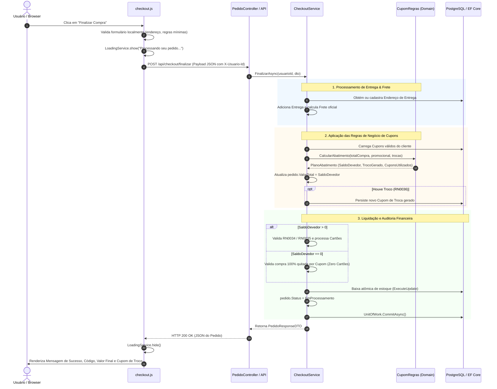

# ⚙️ Regras de Negócio e Engenharia de Checkout

> Documentação detalhada das regras de negócio do core transacional, regras de pagamento multimeios, cupons e ciclo de processamento do checkout do **Glaciar E-Commerce**.

---

## 📌 1. Visão Geral do Checkout

O processamento do checkout é orquestrado pelo serviço de aplicação [`CheckoutService.cs`](file:///c:/Users/gusta/OneDrive/Área%20de%20Trabalho/estudos/fatec/5%20Sem/LES/glaciar/src/glaciar.Application/Services/Vendas/CheckoutService.cs), delegando regras puras de cálculo de cupons para a classe de domínio [`CupomRegras.cs`](file:///c:/Users/gusta/OneDrive/Área%20de%20Trabalho/estudos/fatec/5%20Sem/LES/glaciar/src/glaciar.Application/Services/Vendas/CupomRegras.cs) e encapsulando toda a persistência em uma transação única via `UnitOfWork`.

O fluxo compreende:
1. Obtenção ou cadastro do endereço de entrega selecionado.
2. Cálculo oficial de frete com base no estado do endereço (RF0034).
3. Abatimento de cupons conforme regras estritas de precedência (RN0033, RN0036).
4. Liquidação do saldo devedor restante através de múltiplos cartões ou quitação integral por cupom (RN0034, RN0035).
5. Baixa atômica de estoque via banco de dados e atribuição do status inicial **`EmProcessamento`** (RF0038).

---

## 💳 2. Regras de Negócio Transacionais

```
                                  REGRAS DE PAGAMENTO E CUPONS
┌─────────────────────────────────────────────────────────────────────────────────────────────────┐
│                                                                                                 │
│  [ RN0033 ] Máx. 1 Cupom Promocional      [ RN0034 ] Min. R$ 10,00 por Cartão                   │
│  • Apenas 1 promocional por compra.       • Cobrança mínima de R$ 10,00 em cada cartão de       │
│  • Cupons de troca são ilimitados.          crédito quando não houver abatimento especial.      │
│                                                                                                 │
│  [ RN0035 ] Exceção de Saldo Misto        [ RN0036 ] Troco em Cupom de Troca                    │
│  • Se cupons abaterem o saldo deixando    • Cupons de troca superiores ao total quitam 100%     │
│    restante < R$ 10,00, o cartão pode       da compra (R$ 0,00) e geram um NOVO cupom com o     │
│    ser cobrado com o valor residual.        valor excedente. Cupons extras são rejeitados.      │
│                                                                                                 │
└─────────────────────────────────────────────────────────────────────────────────────────────────┘
```

### 🏷️ 2.1 RN0033 — Limite de Apenas Um Cupom Promocional
* É permitido utilizar **no máximo 1 (um) cupom promocional** por compra.
* Cupons de **troca** podem ser acumulados sem restrição de quantidade.
* **Ordem de Aplicação:** O cupom promocional possui prioridade e é abatido primeiro do total da compra. Em seguida, os cupons de troca são debitados sucessivamente sobre o saldo devedor restante.
* A tentativa de aplicar um segundo cupom promocional no mesmo pedido é rejeitada tanto na interface quanto pelo backend com `DomainValidationException` (HTTP 400).

### 💳 2.2 RN0034 — Pagamento Multimeios com Piso Mínimo de R$ 10,00
* O cliente pode distribuir o valor a ser pago entre múltiplos cartões de crédito.
* Cada cartão participante da transação deve receber uma cobrança de **no mínimo R$ 10,00**.
* A soma dos valores declarados nos cartões deve corresponder exatamente ao saldo devedor restante da compra. Caso a soma seja divergente ou algum cartão receba cobrança inferior a R$ 10,00, a transação é bloqueada com `DomainValidationException` (HTTP 400).

### 🔀 2.3 RN0035 — Exceção do Valor Mínimo em Pagamento Misto (Cupom + Cartão)
* **Regra de Flexibilização:** Se o cliente aplicar cupons de desconto que cubram quase a totalidade da compra, resultando em um **saldo devedor residual inferior a R$ 10,00** (por exemplo: total de R$ 105,00, cupom abate R$ 100,00, restando R$ 5,00), o sistema **permite** a cobrança deste valor menor que R$ 10,00 no cartão de crédito.
* Essa exceção viabiliza a conclusão legítima da compra sem forçar o cliente a emitir cobranças artificiais para bater piso.

### 🪙 2.4 RN0036 — Troco em Cupom de Troca e Proibição de Cupons Desnecessários
* Quando o valor acumulado dos cupons de troca supera o valor total da compra (exemplo: compra de R$ 100,00 paga com cupom de troca de R$ 150,00):
  1. A compra é liquidada integralmente (saldo devedor vai para **R$ 0,00**, dispensando cartões).
  2. O backend gera automaticamente um **novo Cupom de Troca** com o valor do troco (R$ 50,00), vinculado ao cliente e gravado no banco de dados.
  3. `pedido.ValorTotal` é persistido com o valor líquido pago (`R$ 0,00`).
* **Proteção contra Desperdício:** Se o saldo do pedido já estiver totalmente coberto por cupons anteriores, a inclusão de cupons de troca adicionais é **proibida**, evitando que o cliente consuma cupons desnecessariamente.

### 🔒 2.5 Validação Estrutural Obrigatória de Novos Cartões
* Sempre que o cliente informa um novo cartão de crédito no checkout, o backend valida rigorosamente a estrutura cadastral (número com tamanho e formato válidos, bandeira cadastrada, mês entre 1 e 12, ano igual ou superior ao ano corrente, e CVV com 3 ou 4 dígitos).
* Essa validação é **obrigatória e independente** do usuário marcar ou não a opção de salvar o cartão no perfil do cliente (`salvarNoPerfil: true/false`).

---

## 🔄 3. Diagrama de Sequência do Checkout

O fluxo abaixo ilustra a interação completa entre o usuário, o navegador e as camadas do backend:



---

## 🔗 Referências Relacionadas
* [Contratos de API para Checkout e Vendas](./CONTRATOS_API.md)
* [Máquina de Estados e Ciclo de Vida do Pedido](./MAQUINA_DE_ESTADOS.md)
* [Catálogo de Testes Automatizados de Checkout](./CASOS_DE_TESTE.md#--22-módulo-checkout-e-vendas-checkout-vendas-clientes)
